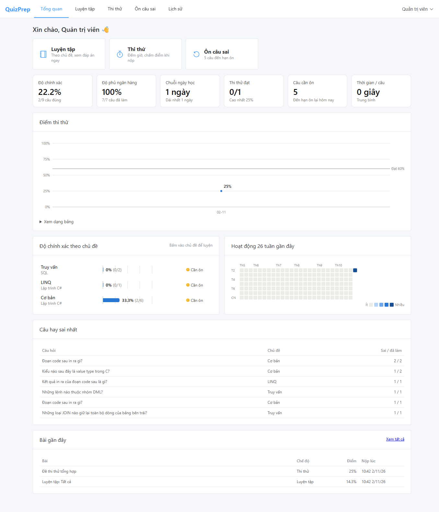
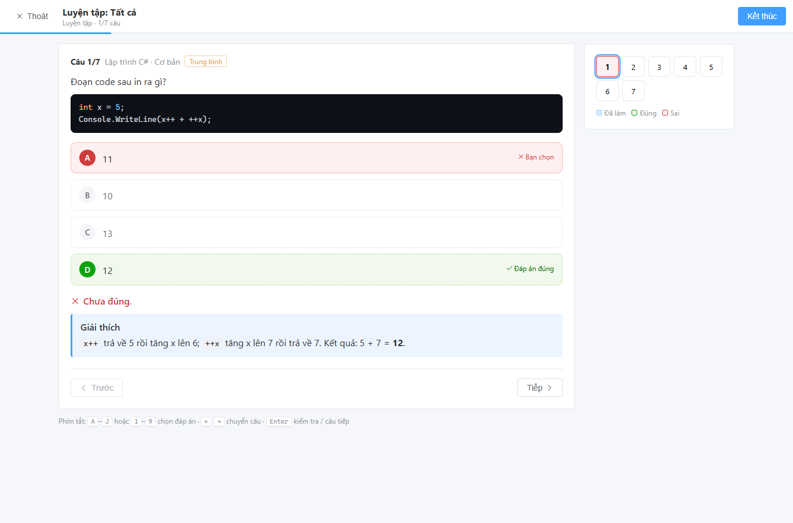
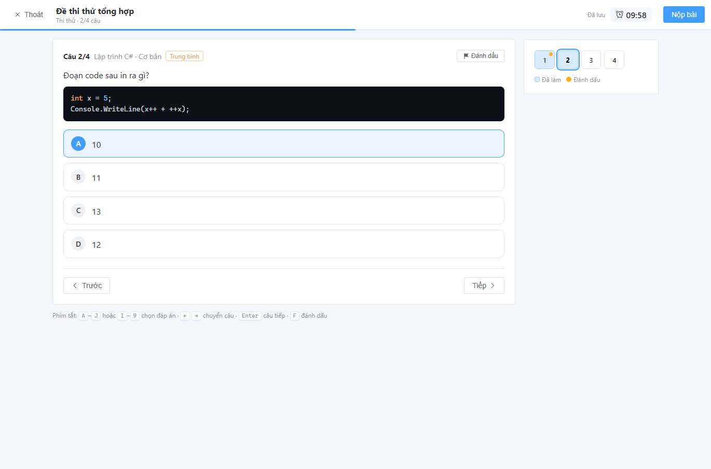
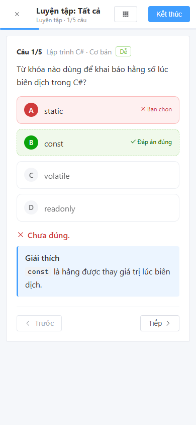
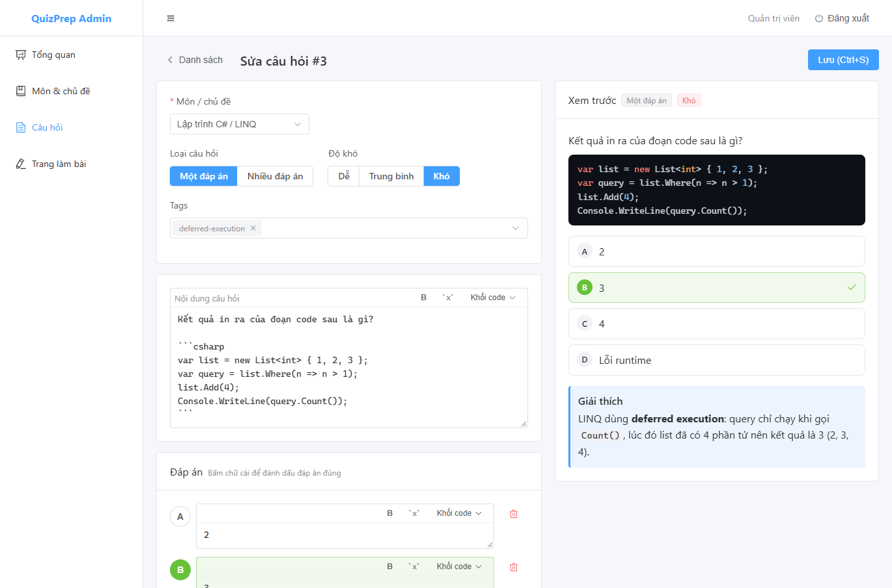
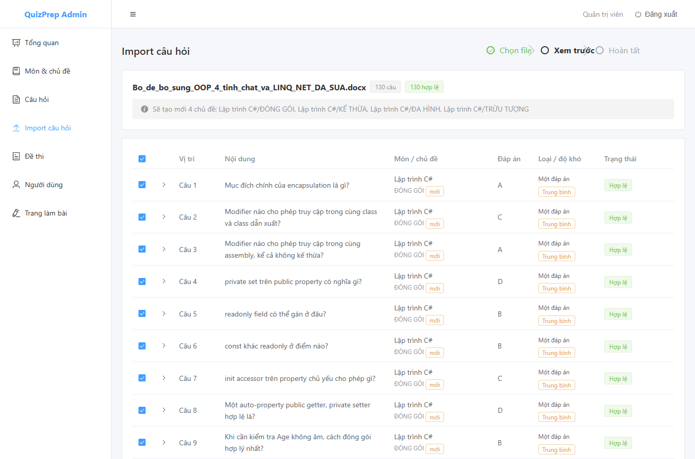

# Hướng dẫn sử dụng QuizPrep

QuizPrep là web app luyện thi trắc nghiệm: soạn hoặc import ngân hàng câu hỏi (có hỗ trợ đoạn code), luyện tập theo chủ đề, thi thử có đếm giờ, ôn lại câu sai và theo dõi tiến độ.

**Mục lục**

1. [Cài đặt và chạy](#1-cài-đặt-và-chạy)
2. [Dành cho học viên](#2-dành-cho-học-viên)
3. [Dành cho quản trị viên](#3-dành-cho-quản-trị-viên)
4. [Định dạng file import](#4-định-dạng-file-import)
5. [Cấu hình](#5-cấu-hình)
6. [Sao lưu dữ liệu](#6-sao-lưu-dữ-liệu)
7. [Xử lý sự cố thường gặp](#7-xử-lý-sự-cố-thường-gặp)

---

## 1. Cài đặt và chạy

### Yêu cầu

| Phần mềm | Phiên bản | Ghi chú |
|---|---|---|
| .NET SDK | 9 trở lên (khuyến nghị 10 LTS) | Chạy backend |
| Node.js | 24 LTS | Chạy frontend |
| SQL Server | Express trở lên | Mặc định dùng `.\SQLEXPRESS`, đăng nhập Windows |

### Chạy lần đầu

```bash
git clone https://github.com/nguyenquydai2003/QuizPrep.git
cd QuizPrep

# Cửa sổ terminal 1 – backend
cd backend/QuizPrep.Api
dotnet run

# Cửa sổ terminal 2 – frontend
cd frontend
npm install
npm run dev
```

Mở trình duyệt tại **http://localhost:5173** và đăng nhập bằng tài khoản mặc định:

| Tên đăng nhập | Mật khẩu |
|---|---|
| `admin` | `Admin@123` |

Lần chạy đầu, backend tự tạo database `QuizPrep`, tài khoản admin, vài câu hỏi mẫu và một đề thi mẫu.

> **Nên làm ngay:** đổi mật khẩu admin trong **Tài khoản** (menu tên bạn ở góc phải), rồi tạo thêm một tài khoản quản trị dự phòng (xem [mục 3.5](#35-người-dùng)).

### Những lần sau

Chỉ cần chạy lại hai lệnh: `dotnet run` (trong `backend/QuizPrep.Api`) và `npm run dev` (trong `frontend`). Dữ liệu được giữ trong SQL Server.

---

## 2. Dành cho học viên

Sau khi đăng nhập, thanh menu phía trên gồm: **Tổng quan · Luyện tập · Thi thử · Ôn câu sai · Lịch sử**.

### 2.1 Tổng quan



| Mục | Ý nghĩa |
|---|---|
| Độ chính xác | Tỷ lệ câu đúng trên tổng số câu đã trả lời |
| Độ phủ ngân hàng | Bạn đã làm bao nhiêu câu khác nhau trong ngân hàng |
| Chuỗi ngày học | Số ngày học liên tiếp tính đến hôm nay |
| Thi thử đạt | Số bài thi đạt / số bài đã thi |
| Câu cần ôn | Số câu sai đến hạn ôn lại |
| Điểm thi thử | Điểm các bài thi theo thời gian, kèm vạch điểm đạt. Rê chuột vào điểm để xem chi tiết |
| Độ chính xác theo chủ đề | Chủ đề yếu nhất nằm trên cùng, dưới 60% có nhãn "Cần ôn". **Bấm vào một chủ đề để luyện ngay 10 câu của chủ đề đó** |
| Hoạt động | Số câu làm mỗi ngày trong 26 tuần gần nhất, màu càng đậm làm càng nhiều |
| Câu hay sai nhất | Những câu bạn sai nhiều lần nhất |

Nếu có bài đang làm dở, mục **Bài đang làm dở** sẽ hiện nút **Làm tiếp**.

### 2.2 Luyện tập

1. Vào **Luyện tập**, chọn:
   - **Phạm vi**: một môn, một chủ đề, hoặc để trống để lấy tất cả.
   - **Độ khó**: Tất cả / Dễ / Trung bình / Khó.
   - **Số câu**: câu được bốc ngẫu nhiên.
   - **Chỉ câu chưa làm bao giờ**: bật lên để ưu tiên câu mới.
2. Bấm **Bắt đầu luyện tập**.
3. Với mỗi câu: chọn đáp án → bấm **Kiểm tra** → xem đúng/sai và lời giải thích → **Tiếp**.



- Câu đã kiểm tra thì không sửa được nữa.
- Câu có nhãn **"Chọn tất cả đáp án đúng"** là câu nhiều đáp án: phải chọn đủ và đúng hết mới được tính đúng.
- Bấm **Kết thúc** bất cứ lúc nào. Câu chưa làm không bị tính điểm.

### 2.3 Thi thử

1. Vào **Thi thử**, mỗi thẻ là một đề: số câu, thời gian, điểm đạt và kết quả các lần bạn đã thi.
2. Bấm **Bắt đầu thi** → **Bắt đầu**. Đồng hồ chạy ngay từ lúc này.



| Tính năng | Cách hoạt động |
|---|---|
| Đồng hồ | Tính theo giờ máy chủ: F5 hay đóng trình duyệt **không** làm dừng hay reset giờ. Còn 5 phút đồng hồ chuyển màu vàng, còn 1 phút chuyển đỏ |
| Tự lưu | Mỗi lần chọn đáp án đều được lưu ngay (góc trên ghi "Đã lưu") |
| Đánh dấu | Nút **Đánh dấu** (phím `F`) để nhớ câu cần xem lại, câu đó có chấm vàng trên lưới |
| Lưới câu hỏi | Bên phải (trên điện thoại: nút ▦). Ô xanh là câu đã làm, bấm vào số để nhảy tới câu đó |
| Nộp bài | **Nộp bài** ở góc trên. App báo trước số câu còn bỏ trống và số câu đang đánh dấu |
| Hết giờ | Bài tự động được nộp |

- Trong lúc thi **không** xem được đáp án. Đáp án chỉ hiện sau khi nộp.
- Điểm = số câu đúng / tổng số câu của đề. Câu bỏ trống tính là sai.
- Mỗi lần thi, đề được bốc ngẫu nhiên lại nên không lần nào giống lần nào. Thứ tự đáp án cũng có thể bị xáo.

### 2.4 Xem kết quả

Sau khi nộp bài hoặc kết thúc luyện tập, màn kết quả hiển thị:

- Điểm số, trạng thái **Đạt / Chưa đạt** (với thi thử), số câu đúng và thời gian làm.
- Bảng **Theo chủ đề** cho biết chủ đề nào làm tốt, chủ đề nào còn yếu.
- Danh sách câu hỏi, lọc được theo **Sai / Đúng / Bỏ trống / Đánh dấu**, kèm đáp án đúng và lời giải thích.
- Các nút **Thi lại đề này**, **Luyện tiếp**, **Ôn câu sai**.

### 2.5 Ôn câu sai

Mỗi câu bạn từng trả lời sai được đưa vào lịch ôn theo phương pháp **lặp lại ngắt quãng (hộp Leitner)**:

| Hộp | Ôn lại sau |
|---|---|
| 1 (vừa trả lời sai) | Ôn ngay |
| 2 | 1 ngày |
| 3 | 3 ngày |
| 4 | 7 ngày |
| 5 | 14 ngày |

Trả lời đúng thì câu lên một hộp, nên khoảng cách ôn dài dần. Trả lời sai thì câu quay về hộp 1. Nhờ vậy bạn dành thời gian cho những câu chưa vững.

Vào **Ôn câu sai** → chọn môn (hoặc tất cả) và số câu → **Bắt đầu ôn**. Cách làm giống chế độ luyện tập.

### 2.6 Lịch sử và tài khoản

- **Lịch sử**: mọi bài đã làm, lọc được theo chế độ. Bấm vào một dòng để xem kết quả (hoặc làm tiếp nếu bài chưa xong). Nút 🗑 xóa bài khỏi lịch sử; thống kê ôn tập vẫn được giữ.
- **Tài khoản** (menu tên bạn ở góc phải): đổi tên hiển thị và mật khẩu.

### 2.7 Phím tắt khi làm bài

| Phím | Tác dụng |
|---|---|
| `A` … `J` hoặc `1` … `9` | Chọn / bỏ chọn đáp án |
| `←` `→` | Câu trước / câu sau |
| `Enter` | Luyện tập: kiểm tra, rồi sang câu tiếp · Thi thử: sang câu tiếp |
| `F` | Đánh dấu câu (thi thử) |

App dùng được trên điện thoại; giao diện tự co giãn theo màn hình.



---

## 3. Dành cho quản trị viên

Bấm tên bạn ở góc phải → **Quản trị**. Menu bên trái gồm: **Tổng quan · Môn & chủ đề · Câu hỏi · Import câu hỏi · Đề thi · Người dùng · Trang làm bài**.

### 3.1 Môn và chủ đề

Mỗi câu hỏi thuộc một **chủ đề**, mỗi chủ đề thuộc một **môn** (ví dụ: môn *Lập trình C#* → chủ đề *LINQ*).

- **Thêm môn**: nút góc trên bên phải. **+ Chủ đề**: nút trên thẻ của từng môn.
- Bấm vào số câu hỏi của một chủ đề để xem danh sách câu trong chủ đề đó.
- Muốn xóa môn hoặc chủ đề thì phải xóa (hoặc chuyển) hết câu hỏi bên trong trước.

### 3.2 Soạn câu hỏi

**Câu hỏi → Thêm câu hỏi** (hoặc bấm vào một câu để sửa).



1. Chọn **Môn / chủ đề**, **Loại câu hỏi** (một đáp án / nhiều đáp án), **Độ khó**, **Tags** (gõ rồi Enter để thêm tag mới).
2. Nhập **Nội dung câu hỏi**. Ô soạn thảo hỗ trợ Markdown:
   - **B**: in đậm · `` `x` ``: code trong dòng.
   - **Khối code ▾**: chọn ngôn ngữ để chèn khối code (C#, Java, SQL, Python…).
   - Phím `Tab` thụt lề 4 dấu cách. Muốn rời ô soạn bằng bàn phím thì nhấn `Esc` rồi `Tab`.
3. Nhập các **đáp án**, rồi **bấm vào chữ cái A/B/C… để đánh dấu đáp án đúng** (chữ cái chuyển xanh). Mỗi câu có từ 2 đến 10 đáp án.
4. Nhập **Giải thích** (không bắt buộc). Phần này hiện cho học viên sau khi trả lời.
5. Khung **Xem trước** bên phải hiển thị câu hỏi đúng như học viên sẽ thấy.
6. Bấm **Lưu** (hoặc `Ctrl+S`). Khi thêm mới có thêm nút **Lưu & thêm câu khác**: giữ nguyên môn, chủ đề, độ khó để nhập liên tục cho nhanh.

> App tự chặn **câu trùng**: cùng nội dung và cùng bộ đáp án (dù thứ tự đáp án khác nhau) sẽ bị báo "Câu hỏi này đã tồn tại".

Trang **Câu hỏi** có ô tìm kiếm và bộ lọc theo môn/chủ đề, độ khó, loại câu và tag.

### 3.3 Import câu hỏi từ Excel / Word

**Import câu hỏi** gồm 3 bước:

1. **Chọn file**: kéo thả file `.xlsx` hoặc `.docx` (tối đa 10 MB). Chưa có file thì bấm **Mẫu Excel** / **Mẫu Word** để tải mẫu về điền.
   - **Chủ đề mặc định** (không bắt buộc) dùng cho câu không ghi môn/chủ đề. Câu chỉ ghi chủ đề mà không ghi môn sẽ thuộc môn của chủ đề mặc định này.
2. **Xem trước**: kiểm tra từng câu trước khi lưu.

   

   | Trạng thái | Ý nghĩa |
   |---|---|
   | Hợp lệ | Sẽ được lưu |
   | Cảnh báo | Vẫn lưu được, nhưng nên kiểm tra lại (ví dụ: đáp án đúng được đoán theo chữ in đậm). Rê chuột để xem lý do |
   | Lỗi | Không lưu được (thiếu đáp án đúng, thiếu chủ đề…). Rê chuột để xem lý do |
   | Trùng | Câu đã có trong ngân hàng hoặc lặp lại trong chính file đó |

   - Bấm ▸ ở đầu dòng để xem đầy đủ câu hỏi, các đáp án và lời giải thích.
   - Nhãn **mới** cho biết môn/chủ đề đó chưa có và sẽ được tạo tự động.
   - Câu hợp lệ được chọn sẵn; có thể bỏ chọn những câu không muốn lưu.
3. **Hoàn tất**: bấm **Lưu N câu đã chọn**. App báo số câu đã thêm, số môn/chủ đề mới tạo và lý do của các câu bị bỏ qua.

Quy cách viết file xem [mục 4](#4-định-dạng-file-import).

### 3.4 Đề thi (ma trận)

Đề thi trong QuizPrep là một **ma trận**: mỗi dòng quy định lấy bao nhiêu câu từ môn/chủ đề nào, ở độ khó nào. Mỗi lần học viên bắt đầu thi, app bốc ngẫu nhiên lại theo ma trận, nên mỗi lần ra một đề khác.

**Đề thi → Tạo đề thi**:

| Trường | Ý nghĩa |
|---|---|
| Tên đề, Mô tả | Hiển thị cho học viên |
| Thời gian (phút) | 1–600 phút |
| Điểm đạt (%) | Ví dụ 70 nghĩa là cần đúng ít nhất 70% số câu |
| Xáo thứ tự đáp án | Đảo vị trí A/B/C/D mỗi lần thi. Câu có đáp án kiểu "Cả A và B", "Tất cả đều đúng" sẽ tự động **không** bị xáo |
| Phát hành | Chỉ đề đã phát hành mới hiện cho học viên. Để tắt nếu còn đang soạn |
| Ma trận đề | Mỗi dòng: **Môn hoặc chủ đề** + **Độ khó** (để trống = mọi độ khó) + **Số câu** |

Ví dụ đề "Tuyển .NET Developer – 40 câu, 45 phút":

| Phạm vi | Độ khó | Số câu |
|---|---|---|
| Lập trình C# / ĐÓNG GÓI | Mọi độ khó | 8 |
| Lập trình C# / KẾ THỪA | Mọi độ khó | 8 |
| Lập trình C# / ĐA HÌNH | Mọi độ khó | 8 |
| Lập trình C# / LINQ | Khó | 6 |
| SQL | Mọi độ khó | 10 |

Trong danh sách đề, bấm ▸ để xem từng dòng ma trận đang **cần bao nhiêu câu / ngân hàng có sẵn bao nhiêu**. Đề nào thiếu câu sẽ có nhãn đỏ **Thiếu câu** và không bắt đầu thi được cho tới khi bạn bổ sung câu hỏi. Nút ▶ cho phép thi thử ngay để kiểm tra đề.

### 3.5 Người dùng

**Người dùng → Thêm người dùng**:

- **Tên đăng nhập**: 3–50 ký tự, chỉ gồm chữ không dấu, số và `.` `_` `-`.
- **Mật khẩu**: tối thiểu 6 ký tự. Gửi cho người dùng; họ tự đổi lại trong **Tài khoản**.
- **Vai trò**: *Học viên* chỉ làm bài và xem tiến độ của mình; *Quản trị* có toàn quyền.

Các nút trên mỗi dòng:

| Nút | Tác dụng |
|---|---|
| 📊 | Xem tiến độ học viên (giống trang Tổng quan của họ) |
| ✏️ | Sửa tên hiển thị, vai trò |
| 🔑 | Đặt lại mật khẩu khi người dùng quên |
| 🗑 | Xóa người dùng, **xóa luôn toàn bộ bài làm và thống kê của họ** |

App không cho xóa tài khoản đang đăng nhập và không cho hạ quyền/xóa quản trị viên cuối cùng.

Muốn cho người khác **tự đăng ký**, bật `Auth:AllowRegistration` (xem [mục 5](#5-cấu-hình)); trang đăng nhập sẽ có thêm link **Đăng ký**. Người tự đăng ký luôn có vai trò Học viên.

### 3.6 AI gợi ý lời giải thích (tùy chọn)

Khi đã cấu hình API key của Claude (xem [mục 5](#5-cấu-hình)), trong màn soạn câu hỏi, ô **Giải thích** có thêm nút **Gợi ý bằng AI**:

1. Nhập xong nội dung câu hỏi, các đáp án và đánh dấu đáp án đúng.
2. Bấm **Gợi ý bằng AI** → lời giải thích được điền vào ô.
3. **Đọc lại và sửa nếu cần** trước khi lưu. AI có thể sai; nếu nghi ngờ đáp án đã đánh dấu là sai, nó sẽ thêm dòng "⚠️ Lưu ý".

Chưa có API key thì nút bị mờ. Rê chuột vào nút để xem hướng dẫn bật.

---

## 4. Định dạng file import

### 4.1 Excel (.xlsx)

- Chỉ đọc **sheet đầu tiên**. Dòng tiêu đề nằm trong 10 dòng đầu.
- Bắt buộc có cột **Câu hỏi** và ít nhất 2 cột đáp án **A**, **B** (tối đa đến **J**). Các cột khác không bắt buộc. Tên cột viết có dấu hay không dấu, hoa hay thường đều được.

| Môn | Chủ đề | Độ khó | Câu hỏi | A | B | C | D | Đáp án | Giải thích | Tags |
|---|---|---|---|---|---|---|---|---|---|---|
| Lập trình C# | Cơ bản | Dễ | Từ khóa nào khai báo hằng số? | static | const | readonly | volatile | B | `const` là hằng lúc biên dịch. | từ-khóa |
| SQL | Truy vấn | Khó | Lệnh nào thuộc nhóm DML? | INSERT | CREATE | UPDATE | DROP | A, C | | dml |

| Cột | Giá trị hợp lệ |
|---|---|
| Độ khó | `Dễ` / `Trung bình` / `Khó` (hoặc `1` / `2` / `3`). Để trống = Trung bình |
| Đáp án | Một chữ cái (`B`) hoặc nhiều chữ cái (`A, C`). Nhiều đáp án đúng thì câu tự thành loại "nhiều đáp án" |
| Tags | Phân tách bằng dấu phẩy |
| Code trong ô | Xuống dòng trong ô bằng `Alt+Enter` và bọc code như sau: |

````
Đoạn code sau in ra gì?
```csharp
int a = 10, b = 3;
Console.WriteLine(a / b);
```
````

### 4.2 Word (.docx)

```
Môn: Lập trình C#                  ← áp dụng cho các câu phía sau
Chủ đề: Cơ bản                     ← hoặc dùng style Heading 1/2/3 làm tên chủ đề

Câu 1: Đoạn code sau in ra gì?
int x = 5;                         ← đoạn viết bằng font Consolas / Courier New = code
Console.WriteLine(x++ + ++x);
A. 10
B. 11
*C. 12                             ← dấu * đánh dấu đáp án đúng
D. 13
Độ khó: Trung bình                 ← không bắt buộc
Tags: toán-tử                      ← không bắt buộc
Giải thích: x++ trả về 5 rồi x = 6; ++x tăng x lên 7. Kết quả 12.
```

**Bắt đầu câu hỏi:** dòng `Câu 1:`, `Câu 1.`, `CÂU 1)` hoặc `Question 1`.

**Đáp án:** dòng bắt đầu bằng `A.` hoặc `A)`. Có thể viết nhiều đáp án trên một dòng, cách nhau bằng **Tab**: `A. string⇥B. object⇥C. struct⇥D. class`.

**Đánh dấu đáp án đúng** (chọn một trong các cách):

| Cách | Ví dụ |
|---|---|
| Dấu `*` trước chữ cái | `*C. 12` |
| Dòng "Đáp án" ngay trong câu | `Đáp án: C` hoặc `Đáp án: B, C` |
| Định dạng | In đậm / gạch chân / tô đỏ **cả** đáp án đúng (app sẽ cảnh báo để bạn kiểm tra lại) |
| Mục đáp án cuối file | Xem bên dưới |

**Mục đáp án cuối file:** đặt một tiêu đề **ĐÁP ÁN** hoặc **ĐÁP ÁN VÀ GIẢI THÍCH** (style Heading, hoặc một dòng in đậm), bên dưới mỗi dòng là một đáp án:

```
ĐÁP ÁN VÀ GIẢI THÍCH
Câu 1 — C. x++ trả về 5 rồi x = 6; ++x tăng x lên 7.
Câu 2 — B, D. Giải thích...
3. A
```

> ⚠️ Đáp án cuối file được ghép với câu hỏi **theo số câu**, nên số ở mục đáp án phải khớp đúng số câu hỏi. Nếu người soạn xếp đáp án theo thứ tự khác với đề (ví dụ "toàn bộ câu lý thuyết trước, câu code sau"), mọi câu đều trông hợp lệ nhưng đáp án sẽ sai. Hãy mở rộng vài câu ở bước **Xem trước** để đối chiếu trước khi lưu.

**Lưu ý khác:**

- **Tắt đánh số tự động (Numbering)** cho "Câu 1", "A." – chữ phải là chữ thật gõ vào, không phải số do Word tự sinh.
- **Hình ảnh** trong câu hỏi chưa được hỗ trợ: app bỏ qua hình và hiện cảnh báo.
- Nếu đánh số câu lại từ 1 ở mỗi phần, app không ghép được mục đáp án cuối file (sẽ cảnh báo "Có nhiều câu cùng số").
- Ngôn ngữ của khối code được đoán từ tên môn/chủ đề (ví dụ "Lập trình C#" → C#), hoặc từ chính nội dung code. Muốn chỉ định rõ thì thêm dòng `Ngôn ngữ: Java` trước các câu.

---

## 5. Cấu hình

Các thiết lập nằm trong `backend/QuizPrep.Api/appsettings.json`. Sửa xong thì khởi động lại backend.

| Khóa | Mặc định | Ý nghĩa |
|---|---|---|
| `ConnectionStrings:Default` | `.\SQLEXPRESS`, database `QuizPrep` | Chuỗi kết nối SQL Server |
| `Auth:AllowRegistration` | `false` | `true` để người dùng tự đăng ký tài khoản |
| `Jwt:ExpiresMinutes` | `720` | Thời gian giữ đăng nhập (phút) |
| `Jwt:SigningKey` | (bản dev trong `appsettings.Development.json`) | Khóa ký phiên đăng nhập, tối thiểu 32 ký tự |
| `Anthropic:ApiKey` | trống | API key Claude để bật "Gợi ý bằng AI" |
| `Anthropic:Model` | `claude-opus-5-5` | Model AI sử dụng |

**Đặt API key mà không ghi vào file** (để không lỡ đẩy key lên GitHub):

```bash
cd backend/QuizPrep.Api
dotnet user-secrets init
dotnet user-secrets set "Anthropic:ApiKey" "sk-ant-..."
```

Hoặc đặt biến môi trường `ANTHROPIC_API_KEY`.

> **Bảo mật:** mật khẩu admin mặc định `Admin@123` và khóa JWT trong `appsettings.Development.json` chỉ dành cho chạy trên máy cá nhân. Nếu đưa app lên server, phải đặt khóa và mật khẩu mới (qua user-secrets hoặc biến môi trường) và đổi mật khẩu admin.

---

## 6. Sao lưu dữ liệu

Toàn bộ dữ liệu (câu hỏi, đề thi, người dùng, lịch sử làm bài) nằm trong database `QuizPrep` của SQL Server.

**Sao lưu:**

```bash
sqlcmd -S ".\SQLEXPRESS" -E -C -Q "BACKUP DATABASE QuizPrep TO DISK = N'QuizPrep.bak' WITH INIT"
```

File `.bak` được ghi vào thư mục backup mặc định của SQL Server, thường là `C:\Program Files\Microsoft SQL Server\MSSQL16.SQLEXPRESS\MSSQL\Backup\`. Hãy chép file này ra nơi khác để cất giữ.

**Khôi phục** (dừng backend trước):

```bash
sqlcmd -S ".\SQLEXPRESS" -E -C -Q "RESTORE DATABASE QuizPrep FROM DISK = N'QuizPrep.bak' WITH REPLACE"
```

Ngoài ra, giữ lại các file Word/Excel gốc cũng là một cách sao lưu ngân hàng câu hỏi: import lại sẽ tự bỏ qua câu trùng.

---

## 7. Xử lý sự cố thường gặp

**"Không kết nối được máy chủ. Backend đã chạy chưa?"**
Backend chưa chạy hoặc đã tắt. Mở terminal, chạy `dotnet run` trong `backend/QuizPrep.Api` và đợi dòng `Now listening on: http://localhost:5080`.

**Backend báo lỗi kết nối SQL Server**
Kiểm tra dịch vụ **SQL Server (SQLEXPRESS)** đang chạy (Windows → Services). Nếu dùng instance khác, sửa `ConnectionStrings:Default`.

**"Port 5173 is already in use" / "address already in use" (5080)**
Có một bản app khác đang chạy. Đóng cửa sổ terminal cũ, hoặc tìm và tắt tiến trình:
```powershell
Get-NetTCPConnection -LocalPort 5080,5173 -State Listen | Select-Object LocalPort, OwningProcess
Stop-Process -Id <OwningProcess>
```

**Đang làm bài thì bị đăng xuất**
Phiên đăng nhập hết hạn (mặc định 12 giờ). Đăng nhập lại và vào **Tổng quan → Bài đang làm dở → Làm tiếp**. Đáp án đã chọn vẫn được giữ. Với thi thử, đồng hồ vẫn chạy trong lúc bạn đăng nhập lại.

**Import báo "Thiếu tên môn"**
File chỉ có chủ đề (ví dụ dùng Heading) mà không có dòng `Môn:`. Chọn **Chủ đề mặc định** ở bước 1 (câu sẽ thuộc môn của chủ đề đó), hoặc thêm dòng `Môn: ...` ở đầu file.

**Import báo "Phải có ít nhất một đáp án đúng"**
App không tìm thấy cách đánh dấu đáp án đúng nào. Xem lại [mục 4.2](#42-word-docx) (dấu `*`, dòng `Đáp án:`, hoặc mục đáp án cuối file có số câu khớp).

**Đề thi báo "Ngân hàng không đủ câu…"**
Một dòng ma trận cần nhiều câu hơn số câu đang có. Giảm số câu của dòng đó hoặc thêm câu hỏi vào chủ đề tương ứng.

**Quên mật khẩu**
- **Học viên**: nhờ quản trị viên đặt lại trong **Người dùng → 🔑**.
- **Quản trị viên**: nhờ một quản trị viên khác đặt lại. Nếu không còn ai khác, có thể xóa tài khoản admin trong database rồi khởi động lại backend; app sẽ tạo lại `admin` / `Admin@123`. Cách này **xóa luôn lịch sử làm bài của tài khoản admin**:
  ```bash
  sqlcmd -S ".\SQLEXPRESS" -E -C -d QuizPrep -Q "DELETE FROM Users WHERE UserName = N'admin'"
  ```
  (Lệnh chỉ có tác dụng khi không còn quản trị viên nào khác.) Vì vậy nên tạo sẵn một tài khoản quản trị dự phòng.

**Muốn xóa sạch dữ liệu và bắt đầu lại**
Dừng backend rồi chạy lệnh dưới đây. Lần chạy sau app tạo lại database với dữ liệu mẫu. **Toàn bộ dữ liệu sẽ mất**, hãy [sao lưu](#6-sao-lưu-dữ-liệu) trước.
```powershell
cd backend
dotnet tool restore
$env:ASPNETCORE_ENVIRONMENT = "Development"   # để đọc cấu hình dev (khóa JWT, chuỗi kết nối)
dotnet ef database drop --project QuizPrep.Api
```
